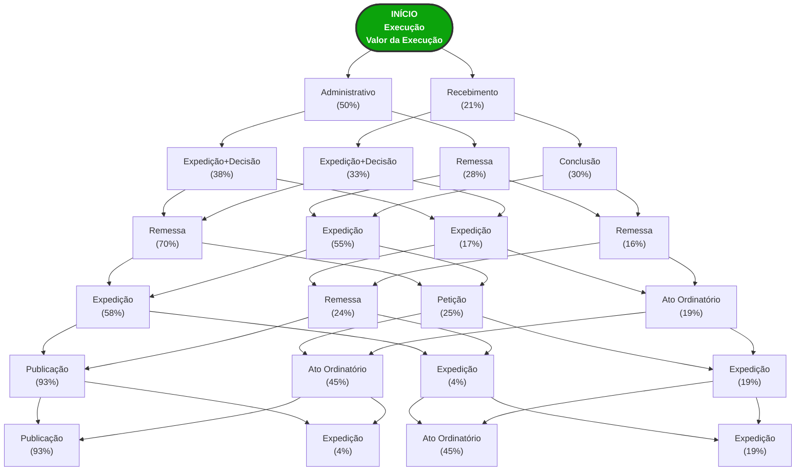

# Fluxograma Simplificado - Valor da Execução

Versão acadêmica com as principais rotas (top 2 por nível)

## Análise Estatística

- **Processos analisados:** 284
- **Total de eventos:** 3415
- **Posição máxima:** 52
- **Posição média:** 12.0
